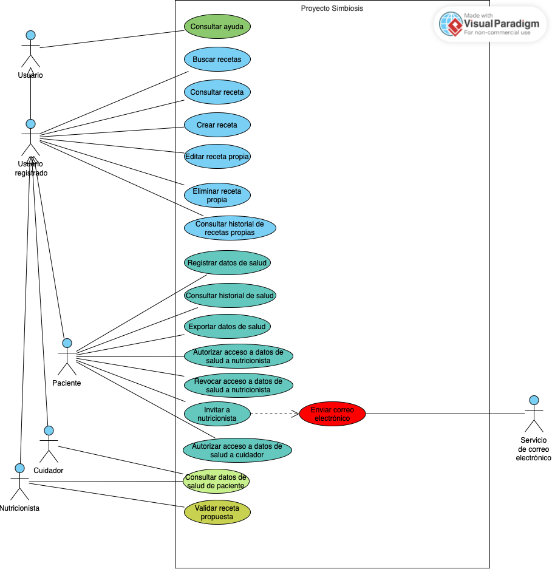

# Modelo de casos de uso de Proyecto Simbiosis

| Versión | Fecha | Estado |
| --- | --- | --- |
| 1.7 | 15/10/2026 | Borrador |

**Iteración de referencia:** E2. Este documento recoge el modelo acumulado tras incorporar la segunda vista de salud y recetas, conservando la primera vista de E1 como punto de partida común.

**Plantilla base:** [Plantilla del modelo de casos de uso](plantilla-modelo-casos-de-uso.md). La plantilla se conserva sin cumplimentar. Los resultados del proyecto se incorporan a este documento.

Los diagramas representan distintas vistas del mismo modelo. Los nombres de los actores y los identificadores de los casos de uso se mantienen entre iteraciones.

## 1 Alcance del modelo

El modelo de casos de uso de Proyecto Simbiosis es acumulativo y se organiza mediante vistas complementarias que comparten la misma frontera del sistema y el mismo conjunto de actores.

**Vista de E1 (Acceso, cuentas y ayuda).** Representa el acceso local, la gestión básica de cuentas y la ayuda seleccionada en el apartado 4 del [plan de E1](../planificacion/plan-iteracion-e1.md). Cubre parte de UR-01, UR-02, UR-03, UR-12 y UR-13. Incluye el registro local y sus condiciones por perfil, la verificación del correo, el inicio de sesión, el restablecimiento de la contraseña, la actualización del perfil, la eliminación de la cuenta propia, la autorización de una relación de cuidado, la gestión básica de cuentas por el coordinador (aprobar, suspender, eliminar y listar cuentas con auditoría de acciones administrativas), la ayuda contextual y la bienvenida.

**Vista de E2 (Salud y recetas).** Incorpora las funciones de datos de salud, acceso autorizado, creación, validación, búsqueda y consulta de recetas, seleccionadas en el apartado 4 del [plan de E2](../planificacion/plan-iteracion-e2.md). Cubre parte de UR-05, UR-06 y UR-08, amplía temas de UR-12 y aplica la identidad pública de UR-01:

- **Datos de salud e historial (UR-05):** registro manual de mediciones fisiológicas, resultados de laboratorio y notas de síntomas o estado de salud (con límite de longitud); consulta del historial por el paciente con filtrado por tipo de variable y gráficas de evolución; y exportación del historial en PDF y CSV. Se contemplan las reglas de corrección de datos del acta de captura de UR-05.
- **Acceso autorizado a datos de salud (UR-05):** concesión y revocación de autorización expresa del paciente a nutricionistas específicos para consultar sus datos de salud; invitación por correo electrónico a nutricionistas sin cuenta previa en la plataforma (con apoyo del Servicio de correo electrónico); y autorización del paciente a su cuidador para consultar datos compartidos concretos. La consulta de datos de salud por cuidadores y nutricionistas requiere autorización previa vigente del paciente.
- **Creación y validación de recetas (UR-06):** creación de recetas con datos obligatorios, ingredientes, instrucciones, categorías y etiquetas; edición de recetas propias; eliminación de recetas propias con confirmación; y consulta del historial de recetas del propio usuario. Las propuestas creadas por pacientes o cuidadores quedan en estado pendiente de validación; un nutricionista con perfil aprobado las revisa y valida, pasando a estado publicado con su correspondiente insignia. Los nutricionistas con perfil aprobado publican directamente sus recetas como validadas.
- **Búsqueda y consulta de recetas (UR-08):** búsqueda por palabras clave, ingredientes incluidos, exclusión de ingredientes y autor; filtros por tipo de comida, tiempo de preparación, dificultad, restricciones dietéticas y alergias/intolerancias del perfil; consulta de resultados con vista previa y ficha detallada de receta validada; y ordenación por fecha o relevancia. El acceso a la búsqueda avanzada requiere que el usuario esté registrado e inicie sesión (FR-119).
- **Identidad pública y ayuda (UR-01, UR-12):** utilización del alias como identidad pública en las recetas (FR-192), separada de los datos clínicos privados; y ampliación de los temas de la guía interactiva y ayuda contextual a la búsqueda y publicación de recetas (FR-173).

**Distinciones de condiciones.** La verificación del correo, la aprobación del perfil profesional por el coordinador, la aceptación de la relación de cuidado, la autorización de acceso a datos de salud y la validación de una receta son condiciones diferentes que no se confunden ni se sustituyen entre sí:
- Una relación de cuidado activa (FR-194 / UC-07 de E1) no confiere acceso automático a los datos de salud del paciente; requiere una autorización expresa de acceso a datos (FR-201 / UC-18). Asimismo, el cuidador no accede a la dirección ni al teléfono del paciente.
- La aprobación de la cuenta profesional de un nutricionista por el coordinador (FR-191 / UC-31 de E1) es un requisito previo de idoneidad, pero no otorga acceso a los datos de ningún paciente sin la autorización explícita de este (FR-045 / UC-15).
- Recibir una invitación por correo no concede acceso a datos de salud: el nutricionista debe completar su registro, verificar su correo, obtener la aprobación del coordinador y recibir la autorización individual del paciente.

**Funcionalidad pendiente acumulada.** El modelo no completa los módulos del sistema. Tras E2, permanecen pendientes para iteraciones posteriores las siguientes funciones (apartado 5 del plan de E2):

- Recordatorios de salud y propuesta profesional de su frecuencia (FR-043, FR-044, FR-199 y FR-200).
- Alertas críticas y gestión o notificación de umbrales clínicos (FR-051, FR-052, FR-202, FR-203 y FR-217).
- Calculadora nutricional y estadísticas completas de recetas (FR-064 y FR-065).
- Ordenación por popularidad o calificación promedio, sugerencias automáticas y recomendaciones basadas en perfil o historial (FR-097, FR-098, FR-100, FR-101, FR-104 a FR-108).
- Notificaciones de nuevas recetas e historial personal de búsquedas guardadas (FR-109, FR-110 y FR-111).
- Guardado de favoritas, listas personalizadas, lectura posterior, descarga e impresión individual, compartición externa y estadísticas de receta (FR-112 a FR-118).
- Foro de discusión, hilos, mensajes directos, consejos de vida saludable, reportes comunitarios, moderación, valoraciones y comentarios (UR-04, UR-07, UR-09, UR-10 y UR-11).
- Registro, acceso y vinculación automática con Google (FR-006, FR-018, FR-190 y NFR-015).
- Bloqueo temporal, expulsión por infracciones y gestión automática de cuentas de cuidador sin pacientes (FR-186, FR-187, FR-209 y FR-210).
- Temas restantes de ayuda, control de progreso entre sesiones, recursos multimedia y buscador de la guía (parte de FR-173, FR-178, FR-179 y FR-180).
- El requisito FR-017 (autenticación en dos pasos) permanece retirado del catálogo.

Los aplazamientos conservan los requisitos del proyecto. El modelo recoge las funciones seleccionadas para el trabajo de requisitos de E1 y E2, aunque algunas queden fuera de sus respectivos prototipos.

## 2 Actores

Un actor representa un rol externo que interactúa con Proyecto Simbiosis. Una misma persona puede desempeñar más de un rol.

| Nombre del actor | Rol que representa |
| --- | --- |
| Usuario | Persona que interactúa con la plataforma. Este rol general permite representar funciones públicas que no exigen una cuenta o sesión iniciada (como consultar la ayuda general). |
| Usuario registrado | Persona que dispone de una cuenta en la plataforma. Actúa como rol base para las funciones que requieren autenticación, tales como la gestión de recetas propias y la búsqueda avanzada de recetas. |
| Paciente | Usuario registrado que gestiona sus propios datos de salud e historial, autoriza o revoca el acceso a sus datos a nutricionistas y cuidadores, invita a profesionales y autoriza relaciones de cuidado. |
| Cuidador | Usuario registrado que mantiene relaciones de cuidado con pacientes y puede consultar los datos de salud compartidos cuando cuenta con la autorización expresa del paciente. |
| Nutricionista | Usuario registrado con cualificación profesional acreditada que puede validar recetas propuestas, publicar directamente recetas validadas y consultar los datos de salud de los pacientes que lo hayan autorizado. |
| Coordinador | Usuario registrado que administra la plataforma: consulta el listado de cuentas y aprueba, suspende o elimina cuentas dentro de sus atribuciones. |
| Servicio de correo electrónico | Sistema externo que presta el servicio de envío de notificaciones y mensajes (verificación de cuenta, restablecimiento de contraseña e invitaciones a nutricionistas). |

**Generalizaciones y relaciones entre actores.**
- `Usuario registrado` especializa a `Usuario`.
- `Paciente`, `Cuidador`, `Nutricionista` y `Coordinador` especializan a `Usuario registrado`. Cada actor especializado hereda la capacidad de participar en los casos de uso asociados al actor general.
- En la vista de E1, `Usuario registrado` agrupaba funciones comunes de acceso y cuenta, mientras que `Cuidador` y `Nutricionista` no contaban con casos exclusivos.
- En la vista de E2, `Usuario registrado` participa directamente en la creación, edición, eliminación y consulta de recetas propias, así como en la búsqueda y consulta de recetas validadas; por herencia, `Paciente`, `Cuidador` y `Nutricionista` pueden ejecutar todas estas operaciones.
- `Paciente` dispone de casos exclusivos para el registro, consulta y exportación de sus datos de salud (`UC-12` a `UC-14`), así como para la gestión de permisos sobre su historial (`UC-15` a `UC-18`).
- `Cuidador` y `Nutricionista` se asocian a `UC-19 Consultar datos de salud de paciente`, accediendo a los datos que el paciente haya decidido compartir con cada uno de ellos.
- `Nutricionista` dispone en exclusiva de la capacidad de validar recetas propuestas (`UC-26`), condicionada a la aprobación previa de su perfil profesional.
- `Coordinador` mantiene sus responsabilidades de administración de cuentas de E1 y no interviene en las funciones clínicas ni de recetas de E2.
- `Servicio de correo electrónico` es un actor externo de apoyo que colabora en el envío de correos en ambas vistas (`UC-11`).
- Los roles de `Paciente` y `Cuidador` no son excluyentes: FR-212 permite explícitamente que una misma cuenta disponga de ambos perfiles a la vez.

El registro de auditoría forma parte del comportamiento interno del sistema y no requiere un actor adicional ni interacción directa con UC-35.

## 3 Casos de uso

Los objetivos de esta tabla son resúmenes. Las descripciones detalladas se incorporan progresivamente según el plan de cada iteración.

| Identificador | Nombre | Objetivo | Participantes |
| --- | --- | --- | --- |
| UC-01 | Registrar cuenta | Solicitar una cuenta local con los datos y las condiciones del perfil elegido. | Principal: Usuario. Apoyo: Servicio de correo electrónico, mediante UC-11. |
| UC-02 | Verificar correo electrónico | Confirmar la dirección de correo como condición para completar el registro. | Principal: Usuario. |
| UC-03 | Iniciar sesión | Establecer una sesión mediante las credenciales de una cuenta cuyo estado permita el acceso. | Principal: Usuario registrado. |
| UC-04 | Restablecer contraseña | Recuperar el acceso mediante un enlace enviado al correo de la cuenta. | Principal: Usuario registrado. Apoyo: Servicio de correo electrónico, mediante UC-11. |
| UC-05 | Actualizar perfil | Modificar los datos personales y las preferencias de la cuenta propia. | Principal: Usuario registrado. |
| UC-06 | Eliminar cuenta propia | Eliminar la cuenta propia tras comprobar la identidad con la contraseña actual. | Principal: Usuario registrado. |
| UC-07 | Autorizar relación de cuidado | Dar autorización expresa para activar una relación de cuidado concreta con un cuidador. | Principal: Paciente. |
| UC-09 | Consultar ayuda | Consultar las instrucciones y guías contextuales de las funciones del sistema (acceso y cuentas en E1; búsqueda y recetas en E2). | Principal: Usuario. |
| UC-10 | Recorrer bienvenida | Conocer las funciones básicas mediante el recorrido del primer acceso, con la posibilidad de omitirlo. | Principal: Usuario registrado. |
| UC-11 | Enviar correo electrónico | Enviar el mensaje que necesita el caso de uso que lo incluye (verificación, restablecimiento o invitación). | Apoyo: Servicio de correo electrónico. Subfunción incluida en UC-01, UC-04 y UC-17. |
| UC-12 | Registrar datos de salud | Introducir mediciones fisiológicas, resultados de laboratorio y notas de síntomas o estado de salud en el historial propio. | Principal: Paciente. |
| UC-13 | Consultar historial de salud | Consultar cronológicamente los datos de salud registrados, filtrar por tipo de variable y visualizar gráficas temporales de evolución. | Principal: Paciente. |
| UC-14 | Exportar datos de salud | Descargar el historial de salud propio en formatos estructurados estándar (PDF y CSV). | Principal: Paciente. |
| UC-15 | Autorizar acceso a datos de salud a nutricionista | Conceder autorización expresa a un nutricionista aprobado para consultar los datos de salud del paciente. | Principal: Paciente. |
| UC-16 | Revocar acceso a datos de salud a nutricionista | Retirar en cualquier momento la autorización concedida previamente a un nutricionista, denegando de inmediato nuevas consultas. | Principal: Paciente. |
| UC-17 | Invitar a nutricionista | Solicitar el envío de un correo de invitación a un nutricionista que aún no dispone de cuenta en la plataforma. | Principal: Paciente. Apoyo: Servicio de correo electrónico, mediante UC-11. |
| UC-18 | Autorizar acceso a datos de salud a cuidador | Conceder permiso a un cuidador asociado para que consulte los datos de salud específicos que el paciente decida compartir. | Principal: Paciente. |
| UC-19 | Consultar datos de salud de paciente | Consultar los datos de salud autorizados de un paciente por parte de un nutricionista con permiso vigente o de un cuidador con relación activa y autorización concedida. | Principal: Cuidador, Nutricionista. |
| UC-20 | Crear receta | Introducir una nueva receta con datos obligatorios, ingredientes, preparación, porciones, tiempos, categorías y etiquetas. | Principal: Usuario registrado. |
| UC-21 | Buscar recetas | Localizar recetas validadas mediante palabras clave, ingredientes incluidos, exclusión de ingredientes, autor, filtros dietéticos y ordenación. | Principal: Usuario registrado. |
| UC-22 | Consultar receta | Visualizar la ficha detallada de una receta validada, incluyendo ingredientes, preparación, porciones, alias del autor e insignia de validación. | Principal: Usuario registrado. |
| UC-23 | Editar receta propia | Modificar el contenido de una receta creada previamente por el propio usuario. | Principal: Usuario registrado. |
| UC-24 | Eliminar receta propia | Retirar definitivamente de la plataforma una receta propia, previa confirmación expresa. | Principal: Usuario registrado. |
| UC-25 | Consultar historial de recetas propias | Consultar la relación de recetas elaboradas por el propio usuario y conocer su estado (pendiente de validación o validada). | Principal: Usuario registrado. |
| UC-26 | Validar receta propuesta | Revisar profesionalmente una receta propuesta por un paciente o cuidador y aprobar su publicación oficial como receta validada. | Principal: Nutricionista. |
| UC-31 | Aprobar cuenta de cuidador o nutricionista | Aprobar una cuenta solicitada con perfil de cuidador o nutricionista, conforme a las condiciones del perfil. | Principal: Coordinador. |
| UC-32 | Suspender cuenta de usuario activa | Suspender una cuenta de usuario que se encuentra activa. | Principal: Coordinador. |
| UC-33 | Eliminar cuenta de usuario | Eliminar una cuenta de usuario y conservar el contenido publicado cuando corresponda a un cuidador. | Principal: Coordinador. |
| UC-34 | Consultar listado de cuentas de usuario | Consultar las cuentas y su información básica: nombre, correo, rol y estado. | Principal: Coordinador. |
| UC-35 | Registrar acción en el historial de auditoría | Registrar la fecha, la hora y la acción realizada al aprobar, suspender o eliminar una cuenta. | Sin participación directa de un actor. Subfunción incluida en UC-31, UC-32 y UC-33. |

**Precisiones sobre los casos de uso:**
- **Reutilización y evolución de alcance en E2:**
  - `UC-09 Consultar ayuda`: mantiene su identificador y su actor principal (`Usuario`). En E2 amplía su cobertura para dar soporte a la búsqueda de recetas y al proceso de creación y validación.
  - `UC-11 Enviar correo electrónico`: actúa como subfunción técnica de envío. En E1 se incluía en `UC-01` y `UC-04`; en E2 se incluye además en `UC-17` para la expedición de la invitación al nutricionista externo.
- **Acceso a datos de salud y permisos:**
  - `UC-18` se distingue explícitamente de `UC-07`: la relación de cuidado (`UC-07`) vincula a cuidador y paciente, pero no autoriza la visualización de datos clínicos (`UC-18`), la cual requiere una decisión informada y selectiva del paciente.
  - `UC-15` y `UC-16` permiten al paciente un control continuo sobre el acceso a su información médica por parte de profesionales, asegurando la revocación inmediata.
  - `UC-19` agrupa el objetivo común de consulta de datos clínicos compartidos, ejercido de forma diferenciada según las autorizaciones concedidas al cuidador o al nutricionista.
- **Ciclo de vida de recetas:**
  - `UC-20`: cuando una receta es creada por un paciente o cuidador, el sistema la guarda en estado pendiente de validación (FR-204). Cuando la crea un nutricionista con perfil aprobado (FR-191), se publica directamente como validada (FR-055).
  - `UC-26`: reservada a nutricionistas aprobados. Su ejecución otorga la insignia oficial de validación (FR-066) y publica la receta para toda la comunidad.
  - `UC-21` y `UC-22`: representan objetivos de usuario distintos; la búsqueda permite filtrar y explorar listados con previsualización, mientras que la consulta carga la ficha completa de la receta.
  - `UC-23`, `UC-24` y `UC-25`: permiten al autor gestionar su producción culinaria. Si se edita una receta ya validada, esta vuelve a requerir validación profesional antes de mantenerse publicada.

## 4 Diagramas del modelo

El modelo se documenta mediante diagramas que corresponden a distintas vistas coherentes entre sí. Todas las vistas utilizan la misma frontera del sistema y la misma jerarquía de actores.

### 4.1 Vista de acceso, cuentas y ayuda de E1

**Frontera del sistema:** Proyecto Simbiosis.

**Alcance:** Registro y acceso local, condiciones por perfil, gestión básica de cuentas, ayuda contextual y bienvenida. La vista contiene siete actores y los quince casos de uso iniciales (UC-01 a UC-07, UC-09 a UC-11 y UC-31 a UC-35).

**Relaciones entre casos de uso en E1:**
- `UC-01` y `UC-04` incluyen (`<<include>>`) a `UC-11`. Ambos necesitan enviar un correo electrónico para completar el flujo previsto. La participación del `Servicio de correo electrónico` se formaliza mediante su asociación con `UC-11`.
- `UC-31`, `UC-32` y `UC-33` incluyen (`<<include>>`) a `UC-35`. Cuando el Coordinador ejecuta una de estas operaciones administrativas, el sistema audita automáticamente fecha, hora y acción realizada.
- `UC-34` no incluye `UC-35`, pues la simple consulta del listado no requiere auditoría de modificación de cuentas según FR-185.
- La vista no utiliza relaciones de extensión (`<<extend>>`) ni dependencias artificiales con el inicio de sesión.

### 4.2 Vista de salud y recetas de E2

**Frontera del sistema:** Proyecto Simbiosis.

**Alcance:** Gestión de datos fisiológicos y de laboratorio (registro, consulta y exportación); gestión de autorizaciones clínicas a nutricionistas y cuidadores (incluida la revocación e invitación externa); creación, edición, eliminación y seguimiento de recetas propias; búsqueda avanzada y consulta de recetas validadas; y validación profesional de propuestas.

**Estructura y relaciones de la vista de E2:**
- **Participación por herencia:** `Usuario registrado` está directamente asociado a los casos de recetas (`UC-20 Crear receta`, `UC-21 Buscar recetas`, `UC-22 Consultar receta`, `UC-23 Editar receta propia`, `UC-24 Eliminar receta propia` y `UC-25 Consultar historial de recetas propias`). Dado que `Paciente`, `Cuidador` y `Nutricionista` especializan a `Usuario registrado`, todos ellos heredan la capacidad de realizar estas actividades.
- **Participación de Paciente:** `Paciente` se asocia en exclusiva con los casos relativos a sus propios datos de salud (`UC-12 Registrar datos de salud`, `UC-13 Consultar historial de salud`, `UC-14 Exportar datos de salud`), así como con los casos de gestión de permisos sobre su historial (`UC-15`, `UC-16`, `UC-17` y `UC-18`).
- **Participación de Cuidador y Nutricionista:** ambos actores se asocian a `UC-19 Consultar datos de salud de paciente`, interviniendo como consultores de los datos que el paciente les haya autorizado específicamente.
- **Participación exclusiva de Nutricionista:** `Nutricionista` se asocia en exclusiva a `UC-26 Validar receta propuesta`, ejerciendo su potestad técnica de revisión.
- **Relaciones de inclusión:** `UC-17 Invitar a nutricionista` incluye (`<<include>>`) a `UC-11 Enviar correo electrónico`. La participación del actor externo `Servicio de correo electrónico` se produce a través de su asociación con `UC-11`.
- **Independencia funcional:** no se emplean relaciones `<<extend>>`. La búsqueda (`UC-21`) y la consulta detallada (`UC-22`) representan interacciones completas e independientes. `Consultar ayuda` (`UC-09`) permanece disponible para `Usuario`.

## 5 Respaldo en los requisitos

Los identificadores remiten al [catálogo canónico de requisitos](../requisitos/catalogo-requisitos.md), versión 1.13, y a la [SRS](../requisitos/srs.md), versión 0.14. UR identifica un requisito de usuario; FR, un requisito funcional; NFR, un requisito no funcional. Se incorporan además los acuerdos de las actas de captura de requisitos.

| Elemento del modelo | UR y FR de referencia | NFR pertinentes | Relación con los requisitos y decisiones |
| --- | --- | --- | --- |
| UC-01 Registrar cuenta | UR-01; FR-001, FR-002, FR-003, FR-004, FR-005, FR-007, FR-008, FR-011, FR-012, FR-013, FR-014, FR-188, FR-189, FR-191, FR-193, FR-213, FR-214 y FR-215 | NFR-010 | Registro local, alias único, validaciones, CAPTCHA y aceptaciones independientes. La solicitud profesional incluye el PDF y sus límites; la solicitud de cuidador permite indicar pacientes. |
| UC-02 Verificar correo electrónico | UR-01; FR-003, FR-009, FR-010 y FR-214 | NFR-010 | Confirmación del correo, registro de fecha y hora en UTC y mensajes sobre el estado del registro. No sustituye la aprobación del perfil ni la autorización de cuidado. |
| UC-03 Iniciar sesión | UR-02; FR-015 | NFR-004, NFR-005 y NFR-010 | Acceso local con correo y contraseña. Medición de rendimiento en el prototipo según plan de E1 y E2. |
| UC-04 Restablecer contraseña | UR-02; FR-016 | NFR-010 | Restablecimiento mediante un enlace enviado al correo de la cuenta, sin exigir una sesión iniciada. |
| UC-05 Actualizar perfil | UR-03; FR-019 | NFR-010 | Edición de datos personales y preferencias dietéticas. El alias y el correo no se pueden modificar. Acuerdos de L06 en acta de UC-05. |
| UC-06 Eliminar cuenta propia | UR-03; FR-020; UR-13; FR-211 | NFR-010 | Comprobación de la contraseña actual. El contenido publicado por un cuidador se conserva tras eliminar su cuenta. |
| UC-07 Autorizar relación de cuidado | UR-01; FR-193 y FR-194 | NFR-010 | Cada paciente autoriza expresamente su relación con un cuidador antes de que se active. |
| UC-09 Consultar ayuda | UR-12; FR-172, FR-173 (acceso, cuentas, búsqueda y recetas), FR-174, FR-175, FR-176 y FR-177 | NFR-010 | Guía contextual y temas de ayuda sobre las funciones de E1 y E2, con navegación, pausa, reanudación y cierre. |
| UC-10 Recorrer bienvenida | UR-12; FR-207 | NFR-010 | Recorrido guiado del primer acceso, que se puede omitir y es independiente de la ayuda contextual. |
| UC-11 Enviar correo electrónico | UR-01, UR-02 y UR-05; FR-003, FR-016 y acta UR-05 §2.6 | — | Subfunción común de envío de mensajes (verificación, restablecimiento e invitación a nutricionistas). Participa el Servicio de correo electrónico. |
| UC-12 Registrar datos de salud | UR-05; FR-041, FR-042 y FR-053 | NFR-010 | Introducción de mediciones fisiológicas, resultados de análisis y notas de síntomas. Acta de UR-05 (§2.1 a §2.4) valida unidades, fechas y corrección de datos. |
| UC-13 Consultar historial de salud | UR-05; FR-047, FR-048, FR-049 y FR-216 | NFR-004, NFR-005 y NFR-010 | Visualización cronológica, filtrado por tipo de variable y representación gráfica temporal de evolución de mediciones. |
| UC-14 Exportar datos de salud | UR-05; FR-050 y FR-216 | NFR-010 y NFR-013 | Generación descargable del historial del paciente en formatos estructurados estándar PDF y CSV. |
| UC-15 Autorizar acceso a datos de salud a nutricionista | UR-05; FR-045 y FR-198; UR-01; FR-191 | NFR-010 | Concesión explícita de permiso por paciente a un nutricionista individual verificado. Acta de UR-05 (§2.6). |
| UC-16 Revocar acceso a datos de salud a nutricionista | UR-05; FR-046 y FR-198 | NFR-010 | Retirada inmediata del permiso en cualquier momento, denegando nuevas consultas incluso en sesiones ya abiertas. |
| UC-17 Invitar a nutricionista | UR-05 (acta de captura UR-05, §2.6) | NFR-010 | Envío de correo de invitación a un nutricionista sin cuenta. Incluye UC-11. No otorga acceso inmediato a datos de salud. |
| UC-18 Autorizar acceso a datos de salud a cuidador | UR-05; FR-201; UR-01; FR-193 y FR-194 | NFR-010 | Autorización voluntaria del paciente sobre los datos específicos que desea compartir con su cuidador asociado. Independiente de UC-07. |
| UC-19 Consultar datos de salud de paciente | UR-05; FR-045, FR-201; UR-13; FR-208 | NFR-004, NFR-005 y NFR-010 | Acceso de cuidadores y nutricionistas a datos autorizados. El servidor comprueba los permisos en cada petición. FR-208 extingue el acceso al finalizar la asociación. |
| UC-20 Crear receta | UR-06; FR-054, FR-055, FR-056, FR-057, FR-058, FR-059; UR-01; FR-191 y FR-192 | NFR-006 y NFR-010 | Creación con ingredientes, preparación, porciones, tiempos y categorías. Pendiente de validación para usuarios y cuidadores; publicación directa si el autor es nutricionista aprobado. Identidad por alias. |
| UC-21 Buscar recetas | UR-08; FR-085, FR-086, FR-087, FR-088, FR-089, FR-090, FR-091, FR-092, FR-093, FR-094, FR-096, FR-099, FR-102, FR-103 y FR-119 | NFR-004, NFR-005, NFR-010 y NFR-014 | Búsqueda por texto, ingredientes incluidos, ingredientes excluidos y autor; filtros dietéticos y de alergias; ordenación por fecha/relevancia. Acuerdos de L06 en acta de UC-21. Requiere sesión iniciada para búsqueda avanzada (FR-119). |
| UC-22 Consultar receta | UR-08; FR-089 y FR-095; UR-06; FR-056 y FR-066; UR-01; FR-192 | NFR-004, NFR-005 y NFR-010 | Ficha completa de recetas validadas con ingredientes, preparación, autor e insignia de validación oficial. Acta de UC-21 (§2). |
| UC-23 Editar receta propia | UR-06; FR-060 y FR-061 | NFR-006 y NFR-010 | Modificación de recetas por su autor. Si la receta ya estaba validada, requiere nueva revisión profesional (acuerdos técnicos §2.4.1). |
| UC-24 Eliminar receta propia | UR-06; FR-062 | NFR-010 | Supresión definitiva de una receta del propio autor tras confirmación explícita. |
| UC-25 Consultar historial de recetas propias | UR-06; FR-063 | NFR-010 | Listado de recetas creadas por el usuario con indicación de su estado (pendiente o validada). |
| UC-26 Validar receta propuesta | UR-06; FR-066, FR-204 y FR-205; UR-01; FR-191 | NFR-006 y NFR-010 | Exclusivo de nutricionistas con perfil aprobado por el Coordinador. La validación publica la propuesta con insignia oficial. |
| UC-31 Aprobar cuenta de cuidador o nutricionista | UR-13; FR-181; condición profesional de UR-01 en FR-191 | NFR-010 | El Coordinador aprueba cuentas de cuidador y nutricionista. Condición previa indispensable para las funciones profesionales del nutricionista. |
| UC-32 Suspender cuenta de usuario activa | UR-13; FR-182 | NFR-010 | El Coordinador puede suspender cuentas de usuario activas. |
| UC-33 Eliminar cuenta de usuario | UR-13; FR-183 y FR-211 | NFR-010 | El Coordinador puede eliminar cuentas. El contenido publicado por un cuidador se conserva tras eliminar su cuenta. |
| UC-34 Consultar listado de cuentas de usuario | UR-13; FR-184 | NFR-010 | Consulta administrativa de todas las cuentas registradas con indicación de nombre, correo, rol y estado. |
| UC-35 Registrar acción en el historial de auditoría | UR-13; FR-185 | — | Registro automático de fecha, hora y acción ejecutada en aprobaciones, suspensiones y eliminaciones administrativas. |
| Generalizaciones de actores | UR-13; FR-212; UR-08; FR-119; acta de captura general §1 | — | Jerarquía que unifica el comportamiento de usuarios registrados, garantiza que recetas y búsquedas avanzadas se hereden, y admite que una cuenta combine los perfiles de paciente y cuidador. |

**Justificación de acuerdos y decisiones de modelado:**
- **Separación de autorizaciones clínicas y de cuidado:** FR-194 exige la autorización de la relación de cuidado (`UC-07`), pero esta no autoriza el acceso a la historia clínica del paciente. FR-201 fundamenta `UC-18` como una decisión separada y voluntaria del paciente. Asimismo, el cuidador autorizado no accede en ningún caso a los datos de contacto privados (dirección y teléfono) del paciente.
- **Acceso profesional condicionado:** un nutricionista sólo puede intervenir profesionalmente (`UC-19` y `UC-26`) si el Coordinador ha aprobado previamente su titulación (`UC-31`, conforme a FR-191) y, en el caso de datos de salud, si el paciente ha otorgado su autorización personal (`UC-15`, conforme a FR-045 y FR-198).
- **Invitación al nutricionista:** se modela en `UC-17` a partir del apartado 2.6 del acta de UR-05. Incluye a `UC-11` para el envío del correo por el Servicio externo. Se constata formalmente que la invitación no confiere privilegios hasta que el profesional complete el ciclo íntegro de registro, verificación, aprobación y autorización.
- **Requisitos no funcionales pertinentes:**
  - NFR-004 y NFR-005 condicionan los tiempos de respuesta en accesos, búsquedas y consultas de recetas (máximo 2 segundos en el percentil 95 bajo carga de referencia).
  - NFR-006 exige que la publicación de recetas creadas o validadas por nutricionistas se complete en menos de 3 segundos bajo carga.
  - NFR-010 exige el cumplimiento de criterios de accesibilidad WCAG 2.2 nivel AA en todos los formularios, vistas y procesos interactivos.
  - NFR-003 y NFR-014 exigen la disponibilidad y coherencia de interfaces y contenidos de recetas en castellano y gallego.
  - NFR-013 orienta la exportación de datos de salud (`UC-14`) hacia formatos estándar y abiertos (PDF y CSV).

## 6 Descripciones de los casos de uso

**Pendiente.** E1 tiene como producto principal el diagrama de la primera vista. Los objetivos del apartado 3 no son descripciones detalladas. Estas se incorporarán cuando se trabajen los casos seleccionados para ese nivel de detalle, con el esquema de la [plantilla base](plantilla-modelo-casos-de-uso.md#6-descripciones-de-los-casos-de-uso).

UC-31 a UC-35 disponen de un resumen de objetivo y participantes en el apartado 3. Sus descripciones detalladas quedan pendientes. La descomposición de UC-08 no exige desarrollarlas en esta revisión.

Antes de completar los escenarios afectados, hay que aclarar los estados de las cuentas, las condiciones de aprobación y los efectos de la suspensión. También hay que aclarar el tratamiento de un fallo de envío y las condiciones de los enlaces de verificación y restablecimiento. Son preguntas pendientes del plan de E1. No se dan por resueltas en este documento.

Repite el esquema siguiente para cada caso seleccionado. Conserva sus referencias y el alcance real de la descripción. El esquema permanece sin cumplimentar; no incorpora soluciones.

### 6.1 Descripción de un caso

**Identificador y nombre:** [Indica el caso.]

**Estado de la descripción:** [Indica el nivel de detalle y el alcance desarrollado.]

**Objetivo:** [Explica qué resultado pretende obtener el participante.]

**Participantes:** [Indica el actor principal y los actores de apoyo, si los hay.]

**Precondiciones:** [Indica qué se da por cumplido al comenzar. Las comprobaciones que realiza el sistema pertenecen al flujo.]

**Inicio:** [Indica qué acción o suceso inicia el caso.]

**Escenario principal:** [Describe la secuencia entre los participantes y el sistema.]

**Alternativas y errores:** [Vincula cada variación a un paso. Indica cómo continúa o termina.]

**Postcondiciones:** [Indica qué queda establecido con éxito y qué se conserva o cambia si el caso termina sin éxito o se cancela. Una consulta no requiere modificar datos para alcanzar su objetivo.]

**Reglas y NFR pertinentes:** [Remite a los requisitos y actas que condicionan el comportamiento.]

**Preguntas abiertas:** [Registra solo las cuestiones necesarias que las fuentes no resuelvan. Si no hay preguntas para el alcance descrito, indícalo.]

## 7 Continuidad entre iteraciones

E1 establece la primera vista del modelo, con siete actores y quince casos de uso: UC-01 a UC-07, UC-09 a UC-11 y UC-31 a UC-35.

En esta revisión, UC-08 Gestionar cuentas se sustituye por UC-31 a UC-35. Se conserva su alcance funcional y se distinguen cuatro objetivos del Coordinador y una subfunción común de auditoría.

UC-08 deja de formar parte del modelo vigente. Su código no se reutiliza y su representación anterior se conserva en Git. Los demás casos mantienen sus identificadores.

La asignación de UC-31 a UC-35 permite conservar los códigos ya acordados para E2 y E3. Estos cinco casos pertenecen a la vista revisada de E1. Su numeración no indica la iteración en la que se utilizan.

E2 partirá de este documento y del [plan de E2](../planificacion/plan-iteracion-e2.md). Se conservarán los elementos que sigan siendo válidos y se incorporarán las nuevas funciones. Un caso existente mantendrá su identificador si conserva el mismo objetivo. Las distintas vistas seguirán perteneciendo a un único modelo de Proyecto Simbiosis.

El modelo recoge resultados del trabajo de requisitos. La arquitectura, el prototipo, las pruebas y la evaluación de E1 se registran en sus documentos correspondientes.

Git conservará las revisiones que se registren en commits, junto con sus imágenes. La referencia al commit de cierre se anotará en la evaluación de la iteración, de acuerdo con la [guía de modelos](README.md).
